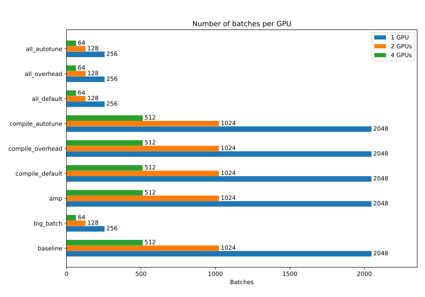
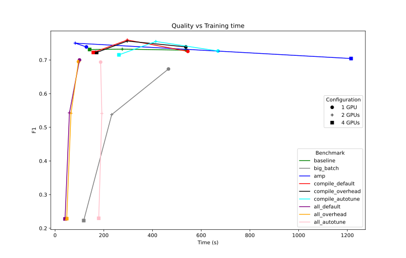
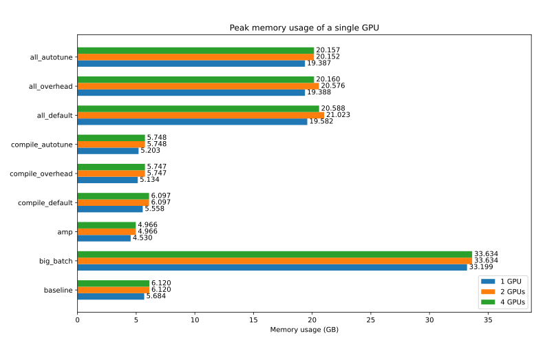
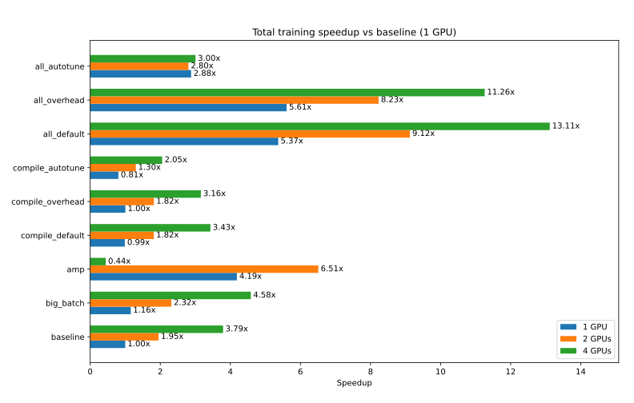
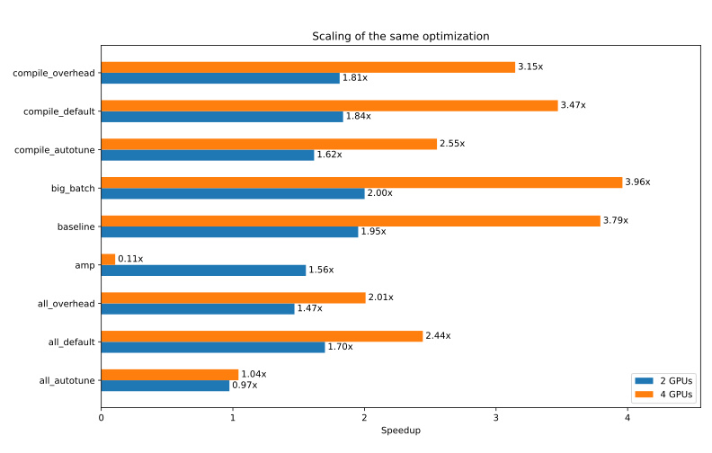

# BERT-Base Fine-Tuning on SQuAD - Distributed Implementation

This project fine-tunes **BERT-base-uncased**
([google-bert/bert-base-uncased](https://huggingface.co/google-bert/bert-base-uncased))
for extractive Question Answering on the **SQuAD** dataset
([rajpurkar/squad](https://rajpurkar.github.io/SQuAD-explorer/)),
using one, two and four GPUs across multiple nodes.

The implementation uses the Hugging Face `transformers` and `datasets` libraries on top of Lightning.

The parallelization technique used is Distributed Data Parallel (DDP),
in which each device holds a complete copy of the model
and the batches are distributed among the devices.
At every step, the gradients are averaged across devices
and the same update is applied to every replica.
This implies a synchronization at every step.

This approach is the simplest when the model fits entirely in the memory of a GPU,
as it simply replicates across multiple devices
the same computation performed in the single-GPU case.
BERT-base (about 110M parameters) fits easily in a 40 GB A100,
so sharded strategies such as FSDP or ZeRO would only add communication overhead
without providing any memory benefit.

# How to use

This is a standard Python project.
You can use the following commands to install the required dependencies:

```sh
python3 -m venv .venv
source .venv/bin/activate
pip install -e .
```

However, the most recent version of PyTorch uses a CUDA version
that is incompatible with the driver version available in the Finisterrae III
(where these benchmarks were run).
Therefore, a specific installation script for this system is provided:

```sh
./install.sh
```

# Project structure

The project structure mimics the BASELINE version.
The helper modules that perform the tokenization and evaluation of the model
(`token_model.py` and `eval_model.py` respectively)
are kept unchanged, so the comparison between the two versions is not affected.

The main logic of the program, contained in `train.py`,
was completely rewritten to adapt it to the Lightning framework.
It now contains:

- `SquadBert`: defines the model (still using `BertForQuestionAnswering`) and how it is trained.
- `SquadData`: defines how to load and tokenize the dataset for training and evaluation.
- `SquadEval`: Lightning callback that periodically evaluates the model during training.
  It also prints the peak memory usage of one GPU, as in the BASELINE version.
- `SaveModel`: Lightning callback that saves the final model parameters to disk.
- `Cli`: manages the CLI arguments of the program.

We are using the `LightningCLI` API,
so the parameters of the BASELINE version no longer apply.
However, the same optimizations can still be enabled: batch size, compilation, mixed precision, etc.
(see `submit_all.sh` for details).
Also, thanks to the built-in Lightning callback `ModelCheckpoint`,
the model is saved several times during training
so that its state can be recovered in case of an error.

The launch scripts were also changed,
but they have the same responsibilities as in the BASELINE version:

- `install.sh`: configures the project's environment and Python libraries for the FT3.
- `test.sh`: dummy job that can be run on an NVIDIA T4 to check that the execution is correct.
- `submit_all.sh`: launches the SLURM jobs with the different benchmark parameters.
- `job.sh`: main SLURM job. Prepares the environment and launches the training script.

Additionally, the script `analyze_results.py` parses the output
of the Lightning simple profiler (`profiler="simple"`)
and generates the plots for this report.

# Benchmark parameters

**Hardware** (unchanged):

| Parameter  | Value                                |
| -          | -                                    |
| CPU        | Intel Xeon Platinum 8352Y (32 cores) |
| GPU        | NVIDIA A100 40 GB                    |
| Filesystem | LUSTRE                               |

**Software versions**:

| Parameter    | Value       |
| -            | -           |
| Python       | 3.10.8      |
| PyTorch      | 2.8.0+cu128 |
| Lightning    | 2.8.0+cu128 |
| CUDA         | 2.6.6       |
| Transformers | 5.17.0      |
| Datasets     | 5.0.1       |

**Model configuration** (unchanged):

| Parameter                | Value                           |
| -                        | -                               |
| Model                    | `google-bert/bert-base-uncased` |
| Dataset                  | SQuAD (`rajpurkar/squad`)       |
| Epochs                   | 4                               |
| Train examples used      | 8192                            |
| Validation examples used | 128                             |
| Batch size               | 16 or 128 (per GPU)             |
| Max sequence length      | 384                             |
| Learning rate            | 2e-5                            |

**Benchmark parameters** (unchanged):

| Benchmark          | Batch size | Compile           | AMP | TF32 |
| -                  | -          | -                 | -   | -    |
| `baseline`         | 16         | No                | No  | No   |
| `big_batch`        | 128        | No                | No  | No   |
| `amp`              | 16         | No                | Yes | No   |
| `compile_default`  | 16         | `default`         | No  | No   |
| `compile_overhead` | 16         | `reduce-overhead` | No  | No   |
| `compile_autotune` | 16         | `max-autotune`    | No  | No   |
| `all_default`      | 128        | `default`         | Yes | Yes  |
| `all_overhead`     | 128        | `reduce-overhead` | Yes | Yes  |
| `all_autotune`     | 128        | `max-autotune`    | Yes | Yes  |

Each configuration was run **once** for each GPU count (1, 2 and 4),
so every value reported below is a single measurement.

# Benchmark results

## Optimizer steps and batch size

When parallelizing across multiple GPUs,
we must consider that the batch size is specified per device,
so the effective (global) batch size grows with the number of GPUs.
However, as the training dataset is fixed,
fewer steps are required to complete it,
which translates into fewer model updates.

The following plot shows the total number of batches processed by each GPU in every benchmark.
For example, in the baseline case,
the 8192 samples of the dataset are split into batches of 16, giving 512 batches per epoch.
Over 4 epochs this makes a total of 2048 steps.
With 2 GPUs, each one processes half of the batches (1024),
and with 4 GPUs, each one processes 512.

| Batch size (per GPU) | 1 GPU | 2 GPUs | 4 GPUs |
| -                    | -     | -      | -      |
| 16                   | 2048  | 1024   | 512    |
| 128                  | 256   | 128    | 64     |



## Model quality

The following graph shows the effect of this on the quality of the model.
Each line is one benchmark, with one point for 1, 2 and 4 GPUs.
The X axis is the total training time and the Y axis is the final F1 score.



| F1                 | 1 GPU | 2 GPUs | 4 GPUs |
| -                  | -     | -      | -      |
| `baseline`         | 0.729 | 0.732  | 0.731  |
| `big_batch`        | 0.673 | 0.538  | 0.223  |
| `amp`              | 0.739 | 0.750  | 0.704  |
| `compile_default`  | 0.726 | 0.760  | 0.722  |
| `compile_overhead` | 0.739 | 0.756  | 0.722  |
| `compile_autotune` | 0.727 | 0.755  | 0.715  |
| `all_default`      | 0.700 | 0.543  | 0.228  |
| `all_overhead`     | 0.695 | 0.542  | 0.229  |
| `all_autotune`     | 0.694 | 0.541  | 0.230  |

For the benchmarks with batch size 16 (`baseline`, `amp` and `compile_*`),
the F1 stays between 0.70 and 0.76 for every GPU count.
The differences among them are small and are most likely noise:
the validation set has only 128 examples (one example is 0.8 points of EM),
and each configuration was run only once.
We can therefore say that AMP and `torch.compile` do not noticeably affect the quality,
and that going from 1 to 4 GPUs with batch size 16 does not either.

The benchmarks `big_batch` and `all_*` use batch size 128,
which divides the number of optimizer steps by 8.
With 1 GPU the loss is moderate (F1 of 0.67 to 0.70, compared to 0.73 for the baseline),
but with 2 and 4 GPUs the global batch grows to 256 and 512
and only 128 and 64 optimizer steps are performed in total.
With the same learning rate (2e-5), this is clearly not enough for the model to converge,
and the F1 drops to about 0.54 and 0.22 respectively.
Scaling the learning rate or increasing the number of epochs could compensate for this,
but it was not explored in this work.
The speedups of these configurations must therefore be interpreted together with this quality loss.

## Memory usage

Another interesting metric is the peak GPU memory usage,
obtained with `torch.cuda.max_memory_allocated()` on one GPU.



- **DDP overhead**: going from 1 GPU to 2 or more adds a consistent overhead of 0.4 to 1.4 GB
  in every benchmark, probably due to the gradient buckets and communication buffers.
  From 2 to 4 GPUs the memory usage is essentially unchanged,
  as expected since each GPU holds a full replica of the model.
- **Batch size**: increasing the batch size from 16 to 128 raises the peak memory
  from 5.7 GB to 33.2 GB on 1 GPU (5.8x), close to the 40 GB available.
- **AMP**: reduces the memory by about 20% with batch size 16 (5.7 GB to 4.5 GB)
  and by about 40% with batch size 128 (33.2 GB in `big_batch` to 19.4 GB in `all_autotune`).
- **Compile**: has little effect on memory (5.1 to 5.6 GB on 1 GPU, compared to 5.7 GB in the baseline).

## Training time

These are the total training times of each benchmark
(time spent in `run_training_epoch`, which includes the compilation that happens in the first epoch):

|                    | 1 GPU   | 2 GPUs  | 4 GPUs      |
| -                  | -       | -       | -           |
| `baseline`         | 538.99s | 276.07s | 142.11s     |
| `big_batch`        | 465.73s | 232.71s | 117.59s     |
| `amp`              | 128.73s | 82.78s  | 1215.50s \* |
| `compile_default`  | 545.21s | 296.68s | 157.11s     |
| `compile_overhead` | 536.91s | 296.39s | 170.68s     |
| `compile_autotune` | 669.26s | 413.75s | 262.34s     |
| `all_default`      | 100.43s | 59.08s  | 41.10s      |
| `all_overhead`     | 96.16s  | 65.50s  | 47.88s      |
| `all_autotune`     | 187.12s | 192.16s | 179.43s     |

\* `amp` with 4 GPUs is an outlier: the mean time per epoch is 304 s, compared to 21 s with 2 GPUs.
The profiler shows that the extra time is spent inside the training epochs and not in the setup,
and the `baseline` benchmark with 4 GPUs does not show this behavior.
<!-- TODO: It is therefore most likely an infrastructure problem in that specific job -->
<!-- (for example, a faulty or overloaded node, or communication issues) -->
<!-- and not a property of AMP with DDP. -->
<!-- It should be repeated to confirm this, and it is excluded from the conclusions below. -->

## Speedup

The next plot presents the speedup with respect to the `baseline` benchmark with 1 GPU.



- **Optimizations on a single GPU**:
  AMP is by far the most effective one, with a 4.19x speedup, thanks to the A100 tensor cores.
  A larger batch size gives only 1.16x, which suggests that the GPU is already well utilized with batch size 16.
  `torch.compile` brings no benefit in this setup:
  `compile_default` (0.99x) and `compile_overhead` (1.00x) are equivalent to the baseline,
  and `compile_autotune` is slower (0.81x).
  This is likely because BERT is dominated by large matrix multiplications that are already efficient,
  while the compilation time is included in the measurement of a short run (4 epochs).
- **Combined optimizations**:
  `all_default` and `all_overhead` reach 5.4x and 5.6x on 1 GPU.
  The product of the individual effects of AMP and the larger batch is 4.19 x 1.16 = 4.85x,
  so the effects add up well, with a small extra gain from the remaining options (fused optimizer, TF32 and compile).
  `all_autotune` only reaches 2.9x because of its compilation cost (see below).
- **Multiple GPUs**:
  the best result is `all_default` with 4 GPUs, with 13.1x (41 s instead of 539 s),
  followed by `all_overhead` (11.3x) and `all_default` with 2 GPUs (9.1x).
  However, with 2 and 4 GPUs these configurations also have a much worse F1,
  so they are not a fair trade-off.
  The best results that keep the quality of the baseline are
  `amp` with 1 and 2 GPUs (4.2x and 6.5x, F1 of 0.74 and 0.75),
  and `all_*` with 1 GPU (5.4x to 5.6x), at the price of 0.03 points of F1.
- **End-to-end time**:
  these speedups only consider the training epochs.
  The total time measured by the profiler also includes everything else (setup, validation, saving, etc.),
  which does not scale with the number of GPUs.
  For the fastest configurations this is significant:
  `all_default` with 4 GPUs spends 41 s in training but 88 s in total,
  so the end-to-end speedup is 6.4x instead of 13.1x.

## Scaling

The following plot shows the speedup of each benchmark with respect to **its own execution with 1 GPU**,
that is, how well each configuration takes advantage of additional GPUs.
The ideal case would be a speedup of 2x with 2 GPUs and 4x with 4 GPUs.



Speedup with respect to the same benchmark on 1 GPU (parallel efficiency in parentheses):

|                    | 2 GPUs       | 4 GPUs         |
| -                  | -            | -              |
| `baseline`         | 1.95x (98%)  | 3.79x (95%)    |
| `big_batch`        | 2.00x (100%) | 3.96x (99%)    |
| `amp`              | 1.56x (78%)  | 0.11x (3%) \*  |
| `compile_default`  | 1.84x (92%)  | 3.47x (87%)    |
| `compile_overhead` | 1.81x (91%)  | 3.15x (79%)    |
| `compile_autotune` | 1.62x (81%)  | 2.55x (64%)    |
| `all_default`      | 1.70x (85%)  | 2.44x (61%)    |
| `all_overhead`     | 1.47x (73%)  | 2.01x (50%)    |
| `all_autotune`     | 0.97x (49%)  | 1.04x (26%)    |

- **`baseline` and `big_batch` scale almost linearly** (95% to 100% efficiency).
  In these cases each step is long enough that the gradient synchronization is a small part of it.
  With `big_batch` the synchronization is also amortized over 8 times more samples per step,
  so it scales slightly better than the baseline.
- **The efficiency drops as the optimizations make each step faster.**
  With AMP, the efficiency with 2 GPUs falls to 78%,
  and in `all_*` to 73%-85% with 2 GPUs and 50%-61% with 4 GPUs.
  This is the expected behavior (Amdahl's law):
  the cost of the gradient all-reduce (the gradients keep the same size with mixed precision)
  and other fixed costs do not shrink when the computation is accelerated,
  so they represent a larger fraction of the time.
- **`torch.compile` has a fixed cost that does not scale.**
  The efficiency of `compile_*` decreases with the number of GPUs,
  especially for `max-autotune`.
  As a rough estimate, `compile_autotune` takes about 130 s more than the baseline with 1 GPU;
  adding this cost to a perfectly scaled baseline gives 539/4 + 130 = 265 s with 4 GPUs,
  very close to the 262 s measured.
  `all_autotune` is the extreme case: it takes about 180-190 s regardless of the number of GPUs,
  so it does not scale at all (1.04x with 4 GPUs),
  because its time is dominated by the compilation and autotuning and not by the training itself.
- **`reduce-overhead` vs `default`**:
  `reduce-overhead` is slightly faster with 1 GPU, but slower with 4 GPUs
  (170.7 s vs 157.1 s in `compile_*`, and 47.9 s vs 41.1 s in `all_*`).
  A possible cause is the interaction between CUDA graphs and DDP,
  but this was not investigated and the differences are small for a single measurement.
- `amp` with 4 GPUs is the outlier explained above.

# Conclusions

- DDP with Lightning is easy to use and scales almost linearly for the baseline
  (3.79x with 4 GPUs, 95% efficiency).
- The most effective optimization is mixed precision (4.2x on 1 GPU, 6.5x on 2 GPUs)
  and it does not affect the quality.
- Increasing the batch size is only useful in combination with other optimizations,
  and with several GPUs it reduces the number of optimizer steps so much that the model does not converge
  without adjusting the learning rate.
- `torch.compile` does not pay off in such a short training run,
  and `max-autotune` is clearly counterproductive because of its compilation time.
- The more optimized the step is, the worse it scales with more GPUs,
  as fixed costs (communication, compilation, setup) take a larger share of the time.

# Limitations

- Every configuration was run only once, so small differences (a few percent) may be noise.
- The validation set has only 128 examples, so the F1 and EM differences below a few points are not significant.
- The learning rate was not adjusted for the larger global batch sizes.
- The `amp` benchmark with 4 GPUs is an outlier that should be repeated.
